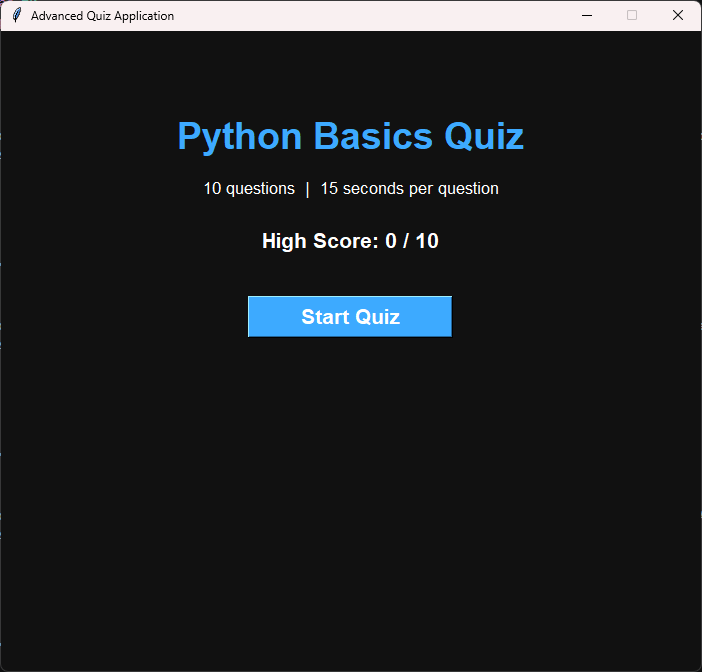
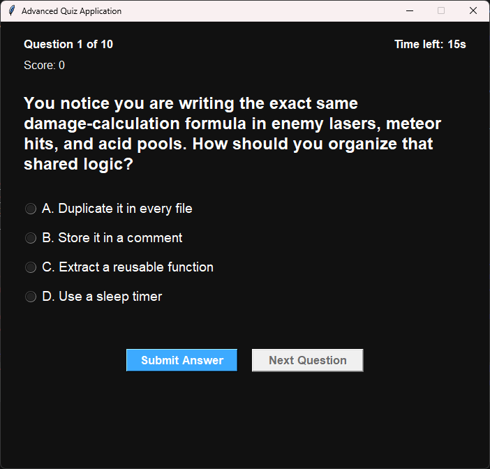
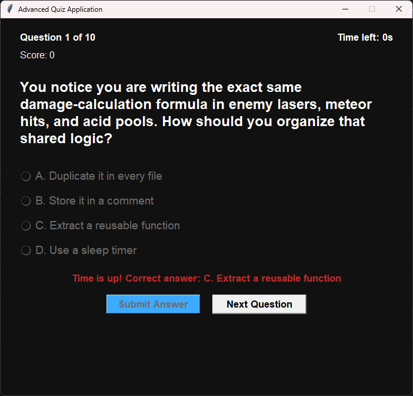
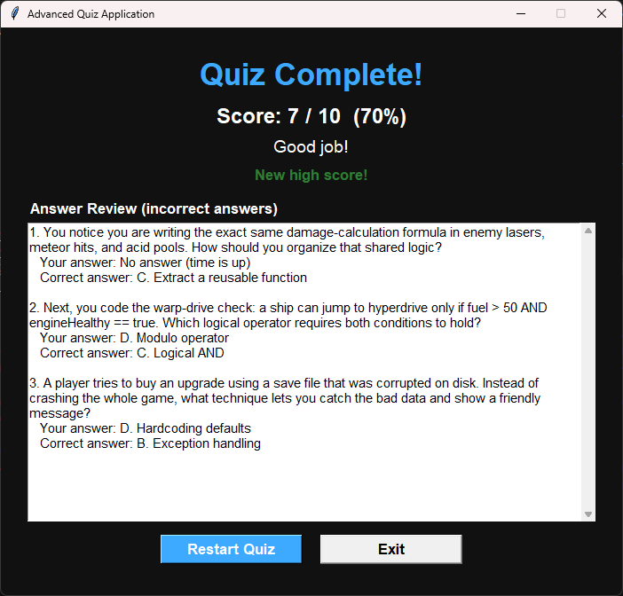

# pythoin-tkinter-quiz

**Name:** Mehlcon D. Casimero
**Section:** SE 3A
**Topic:** Programming

## Features Completed
- 10 multiple-choice questions
- Random question order
- 15-second countdown timer
- Answer checking and time-out handling
- Score and percentage
- Answer review
- High score saved in a text file
- Restart button

## How the Questions Are Stored and Shuffled
All 10 questions live in a Python list called `QUESTIONS`, where each item is a dictionary containing `"question"`, a list of four `"choices"` (`"A."` through `"D."`), and the expected `"answer"` letter.

When a quiz starts or restarts (`start_quiz()`), `random.sample(QUESTIONS, len(QUESTIONS))` creates a shuffled copy of the full list so players get the questions in a different order each round without mutating the original `QUESTIONS` list.

## How the Timer Works
Each question starts with `time_left = TIME_LIMIT` (15 seconds) and calls `update_timer()`. That function updates the label and uses `root.after(1000, update_timer)` to schedule itself again after 1,000 milliseconds (1 second), counting down until `time_left` hits `0` and triggers `time_up()`.

The timer stops in three situations:
- **Answer submitted:** `submit_answer()` sets `answered = True` and calls `stop_timer()`, which cancels any pending callback using `root.after_cancel(timer_job)`.
- **Time runs out:** `time_up()` sets `answered = True` and stops counting down so no further ticks fire.
- **Window closed:** `on_close()` calls `stop_timer()` before destroying the window so background timer callbacks don't run after exit.

## How the Program Identifies the Correct Answer
Each `tk.Radiobutton` uses `selected_answer` (`tk.StringVar()`) and sets `value=letter` (the first character of each choice string, such as `"A"`, `"B"`, `"C"`, or `"D"`).

When the user clicks **Submit Answer**, `submit_answer()` reads `choice = selected_answer.get()` and compares it directly against the current question's expected letter using `choice == question["answer"]`. If they match, `score` increases by `1`; if not, the attempt is recorded in `wrong_answers` for the end-of-quiz review.

## How the Score and High Score Work
- **Score:** Starts at `0` for each new quiz and increments by `1` whenever `choice == question["answer"]` in `submit_answer()`.
- **Percentage:** Calculated on the results screen (`show_results()`) as `(score / total) * 100` and formatted with `:.0f%` (for example, `80%`).
- **Reading the high score:** `get_high_score()` checks if `high_score.txt` exists next to the script (`HIGH_SCORE_FILE`), opens it in `"r"` mode, strips whitespace, and converts it with `int()`. If the file is missing or contains invalid text (`ValueError`), it safely returns `0`.
- **Saving the high score:** `save_high_score(new_score)` compares `new_score` against `get_high_score()`. If it is strictly higher, it opens `high_score.txt` in `"w"` mode, writes `str(new_score)`, and returns `True` so the results screen can display `"New high score!"`.

## Function Explanations
| Function | Purpose | Called when |
|----------|---------|-------------|
| `get_high_score()` | Reads and returns the saved high score from `high_score.txt` (or `0` if unavailable/corrupt). | At startup on the start screen, when checking if a new high score was set, and when displaying the high score on the results screen. |
| `save_high_score(new_score)` | Writes `new_score` to `high_score.txt` if it beats the current high score. | When reaching the results screen in `show_results()`. |
| `clear_screen()` | Destroys all child widgets inside `main_frame` before rendering a new screen. | When showing the start screen, a question, or the final results. |
| `get_choice_text(question, letter)` | Finds and returns the full choice string matching `letter` (e.g., `"B. Type conversion to integer"`). | When formatting the correct answer in `time_up()` (and when building wrong-answer review entries). |
| `start_quiz()` | Shuffles the questions, resets `current_question`, `score`, and `wrong_answers`, and loads question 1. | When clicking **Start Quiz** on the start screen or restarting the quiz. |
| `show_start_screen()` | Clears the frame and renders the title, quiz rules, high score, and **Start Quiz** button. | When the program first launches (`root.mainloop()` setup). |
| `show_question()` | Resets per-question state, renders the current question, radio choices, and buttons, and starts the timer. | At the start of a quiz and whenever moving to the next question. |
| `update_timer()` | Updates the timer label every second and calls `time_up()` when time reaches `0`. | At the end of `show_question()` and every 1 second via `root.after()` until stopped or answered. |
| `stop_timer()` | Cancels any scheduled `root.after()` timer job and resets `timer_job` to `None`. | When submitting an answer or closing the window (`on_close()`). |
| `lock_choices()` | Disables all choice radio buttons so the user can't change their selection after locking in. | When an answer is submitted (`submit_answer()`) or time expires (`time_up()`). |
| `submit_answer()` | Validates a selection, locks the question, checks if the answer is right/wrong, updates score, and enables **Next Question** / **See Results**. | When clicking the **Submit Answer** button. |
| `time_up()` | Marks the question as unanswered due to timeout, locks choices, records the miss, and enables the next button. | When `update_timer()` reaches `0` seconds. |
| `next_question()` | Advances `current_question` by `1` and either displays the next question or opens the results screen. | When clicking **Next Question** or **See Results**. |
| `show_results()` | Computes the final score and percentage, checks/saves the high score, and displays the answer review box. | After the final question when `next_question()` reaches the end of `quiz_questions`. |
| `restart_quiz()` | Starts a fresh quiz session with reshuffled questions and reset score. | When clicking **Restart Quiz** on the results screen. |
| `on_close()` | Stops the running timer and cleanly closes `root`. | When clicking **Exit** or clicking the window's close (`X`) button. |

## Screenshots

## Challenges I Faced
- **Keeping the timer from running after answering or closing:** If a timer isn't canceled, `root.after()` can keep ticking in the background or fire after widgets are destroyed. Using a `timer_job` ID with `stop_timer()` (`root.after_cancel`) and checking `answered` kept the countdown in sync.
- **Preventing multiple submissions and unanswered clicks:** Without guarding `submit_answer()`, a user could click submit before picking an option or submit twice. Checking `choice == ""` for a warning and using the `answered` flag + `lock_choices()` made each question behave cleanly.
- **Styling the dark-mode radio buttons and `main_frame`:** Switching to `#111111` meant `main_frame` needed `bg=BG_COLOR` so the container matched the theme, and the radio buttons needed explicit foreground and `selectcolor` styling so the selected indicator stayed easy to see.
- **Saving high scores safely across runs:** Storing the score in a text file next to the script (`os.path.abspath(__file__)`) keeps data between sessions, while wrapping `int()` conversion in `try/except ValueError` prevents crashes if the file is empty or edited by hand.
- **Preventing softlocks between the timer and Next button:** Timing out or submitting right as the countdown hit zero could leave the next-question state out of sync. Canceling old timer callbacks with `stop_timer()` and ensuring `next_button.config(state="normal")` always runs when a question finishes prevented getting stuck on a question.